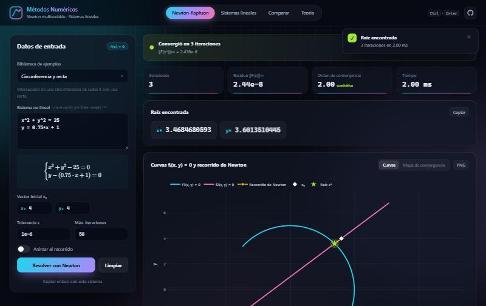
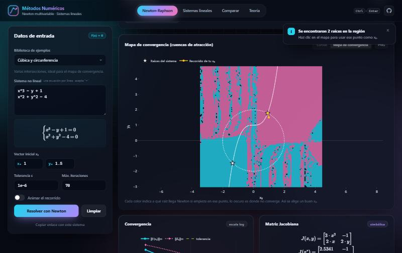
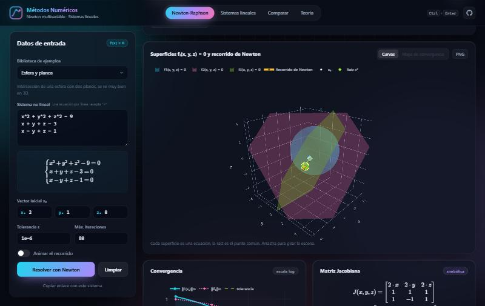
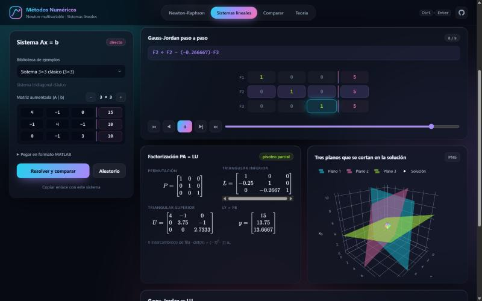

<div align="center">

# Métodos Numéricos · Newton vs Sistemas Lineales

**Newton-Raphson multivariable** frente a **Gauss-Jordan** y **factorización LU**, interactivo, animado y directo en el navegador.

[](https://said1ojeda.github.io/MetodosNumericosPremiumApp/)
[](https://github.com/Said1Ojeda/MetodosNumericosPremiumApp/actions)


[](LICENSE)

### 👉 [Abrir la demo](https://said1ojeda.github.io/MetodosNumericosPremiumApp/)



</div>

## ¿Qué es?

Proyecto final del curso de **Métodos Numéricos** (grupo 6). Empezó como una app de MATLAB App Designer (sigue en [`MetodosNumericosPremiumApp.m`](MetodosNumericosPremiumApp.m)) y la pasé a una aplicación web en TypeScript para que cualquiera la pueda usar sin instalar nada.

La app resuelve, grafica y compara:

| Método | Problema | Tipo |
| --- | --- | --- |
| Newton-Raphson multivariable | Sistemas no lineales F(x) = 0 | Iterativo |
| Gauss-Jordan con pivoteo parcial | Sistemas lineales Ax = b | Directo |
| Factorización LU (PA = LU) | Sistemas lineales Ax = b | Directo |

## Lo más interesante

**Newton-Raphson**
- Escribes las ecuaciones como en el cuaderno (`x^2 + y^2 = 25`) y aparecen en LaTeX mientras escribes.
- **Jacobiana simbólica**: las derivadas parciales se calculan solas. Si no se puede derivar, usa diferencias centradas.
- Gráfica de **curvas implícitas en 2D** y **superficies en 3D** con el recorrido de Newton animado iteración por iteración.
- **Mapa de convergencia** (cuencas de atracción): colorea cada punto del plano según a qué raíz llega Newton si arranca ahí. Se calcula en un *Web Worker* para que la página no se trabe, y con un clic en el mapa eliges el nuevo x₀.
- **Orden de convergencia estimado**: comprueba en vivo que Newton es cuadrático (p ≈ 2).
- Tabla de iteraciones paginada; al tocar una fila se marca el punto en la gráfica. Se puede exportar a CSV.

**Sistemas lineales**
- Editor visual de la matriz aumentada [A | b] de 2×2 hasta 8×8. También acepta pegar en formato MATLAB.
- **Gauss-Jordan animado paso a paso** con reproductor: resalta el pivote y las filas que cambian, y muestra cada operación (`F2 ← F2 − (−0.25)·F1`).
- Factorización **PA = LU** con las matrices P, L, U y el vector intermedio y.
- Determinante, **número de condición** κ∞(A) y residuos de los dos métodos.
- Interpretación geométrica: rectas que se cruzan (2×2) o planos en 3D (3×3).

**Comparación**
- Costo real de Gauss-Jordan contra LU, medido contando operaciones en matrices de hasta 60×60.
- Gráfica de los dígitos correctos que gana Newton en cada iteración.
- Explica cómo se conectan los métodos: **cada iteración de Newton resuelve un sistema lineal con LU**.

**Y además**
- Ejemplos académicos y casos de aplicación real: brazo robótico (cinemática inversa), localización GPS por trilateración, circuito por mallas, armadura estructural y placa de calor.
- Alertas claras para cada error (Jacobiana singular, valores complejos, divergencia, matriz singular). La app nunca se cae.
- Enlaces para compartir: copias un link y quien lo abra ve el mismo sistema ya resuelto.
- Atajo `Ctrl + Enter` para resolver. Funciona en celular y sin internet después de cargar.

<table>
  <tr>
    <td></td>
    <td></td>
  </tr>
  <tr>
    <td align="center"><b>Mapa de convergencia</b></td>
    <td align="center"><b>Esfera y planos en 3D</b></td>
  </tr>
  <tr>
    <td colspan="2"></td>
  </tr>
  <tr>
    <td colspan="2" align="center"><b>Gauss-Jordan paso a paso, factorización LU y planos</b></td>
  </tr>
</table>

## Un poco de teoría

**Newton-Raphson multivariable.** Para resolver F(x) = 0 se lineariza el sistema alrededor del punto actual:

```
J(xₖ) · δₖ = −F(xₖ)
xₖ₊₁ = xₖ + δₖ
```

Se detiene cuando ‖δₖ‖∞ / max(1, ‖xₖ₊₁‖∞) < ε o ‖F(xₖ₊₁)‖∞ < ε. Cerca de la raíz el error se eleva al cuadrado en cada iteración.

**Gauss-Jordan.** Lleva la matriz aumentada `[A | b]` hasta `[I | x]` con operaciones de fila y pivoteo parcial.

**LU.** Factoriza `PA = LU` una sola vez y luego resuelve `Ly = Pb` hacia adelante y `Ux = y` hacia atrás. Es más barato (≈ n³/3 operaciones contra ≈ n³/2) y reutiliza L y U para otro vector b.

La pestaña **Teoría** de la app tiene la explicación completa con fórmulas y la guía de alertas.

## Correrlo en tu compu

Necesitas [Node.js](https://nodejs.org) 20 o más reciente.

```bash
git clone https://github.com/Said1Ojeda/MetodosNumericosPremiumApp.git
cd MetodosNumericosPremiumApp
npm install
npm run dev
```

Abre la dirección que muestra la terminal (por defecto `http://localhost:5173/MetodosNumericosPremiumApp/`).

| Comando | Qué hace |
| --- | --- |
| `npm run dev` | Servidor de desarrollo con recarga automática |
| `npm test` | Pruebas del motor numérico (Vitest) |
| `npm run build` | Revisa los tipos y compila para producción en `dist/` |
| `npm run preview` | Sirve el build para probarlo |

Cada push a `main` corre las pruebas y publica en GitHub Pages con GitHub Actions.

## Estructura

```
src/
├── metodos/          motor numérico, sin nada de interfaz
│   ├── sistema.ts      lee las ecuaciones y arma F(x) y la Jacobiana simbólica
│   ├── newton.ts       Newton-Raphson multivariable y mapa de convergencia
│   ├── gaussJordan.ts  Gauss-Jordan con pivoteo y registro de pasos
│   ├── lu.ts           PA = LU, sustitución, determinante y condición
│   └── ejemplos.ts     biblioteca de ejemplos
├── ui/               vistas, gráficas, tabla paginada y alertas
├── main.ts           arranque y navegación entre pestañas
└── estilos.css
tests/                30 pruebas del motor
MetodosNumericosPremiumApp.m   versión original en MATLAB
```

El motor está separado de la interfaz, así que se puede probar solo y reutilizar.

## Tecnologías

[TypeScript](https://www.typescriptlang.org) · [Vite](https://vite.dev) · [Plotly.js](https://plotly.com/javascript/) para las gráficas · [math.js](https://mathjs.org) para leer y derivar las ecuaciones · [KaTeX](https://katex.org) para las fórmulas · [Vitest](https://vitest.dev) para las pruebas.

Todo corre en el navegador: no usa servidor ni APIs externas.

## Autor

**Said Ojeda Fabián**, [@Said1Ojeda](https://github.com/Said1Ojeda)

## Licencia

[MIT](LICENSE)
